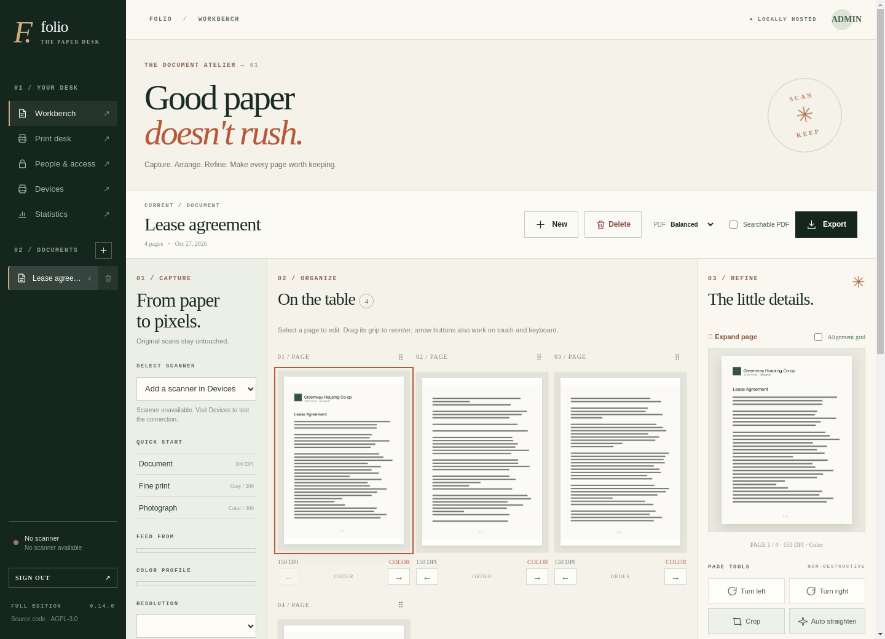
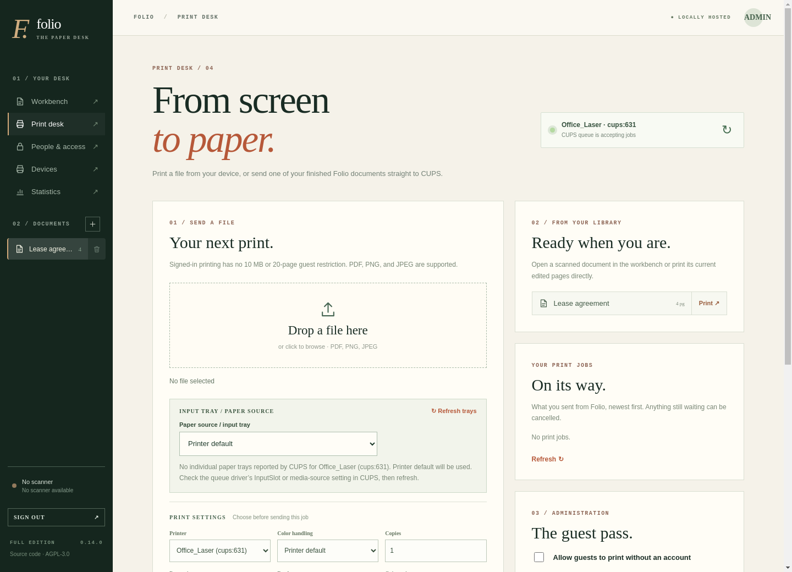
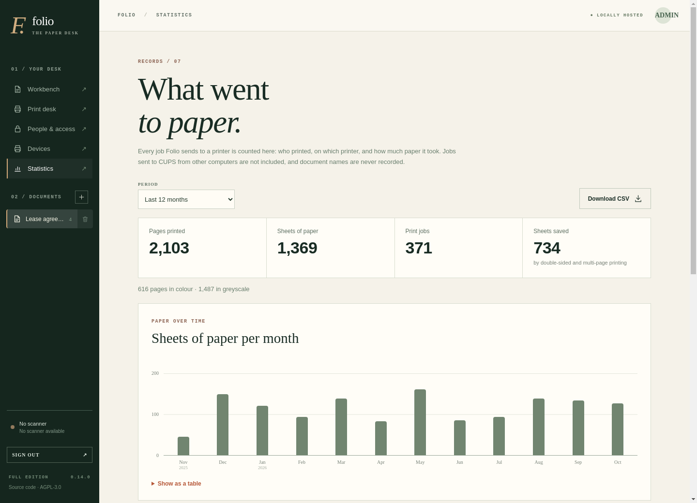

# Folio Scan Studio

**Modern features. Existing hardware. Minimal resources.**

[](https://github.com/kmmukut/folio-scan-studio/actions/workflows/ci.yml)
[](https://github.com/kmmukut/folio-scan-studio/releases)
[](LICENSE)

Folio turns printers and scanners that still work into a private,
browser-based print and scan workstation. Run it on a Raspberry Pi, a mini
PC or the server you already have, and use it from any phone, tablet or
computer on your network.



## Why Folio

Millions of printers and scanners are set aside not because the hardware
failed, but because the manufacturer's software stopped being updated, a
utility no longer runs, or a new operating system dropped the driver. Folio
bridges that gap with open technologies (CUPS, SANE, IPP, eSCL, WSD), so a
small Linux computer can give a working device a modern workflow.

**Replace obsolete software, not functioning hardware.**

We believe:

- Functioning hardware deserves a longer life, and reusing it reduces
  electronic waste.
- A printer should not need replacing because its software is outdated.
- Modern printing and scanning should not depend on cloud subscriptions.
- You should keep ownership of your devices, documents and data.
- A low-cost, low-power computer should be enough.

Folio respects what the hardware can do. It cannot make a monochrome
printer print in colour, but it unlocks everything the device does support
and builds modern workflows around it.

### Vision

Someone should be able to find an old printer in storage, connect it to a
small Linux computer, install Folio and, if the hardware has Linux support,
give it a new role in a home or office. Someone with a server should be
able to do the same without buying anything, and someone with a brand-new
multifunction printer should still benefit from Folio's document workflows
and privacy-conscious design.

### Principles

- **Lightweight:** one container, no external database or message queue,
  and a Lite image for small hosts.
- **Hardware-independent:** paper sizes, trays, duplex, colour, scan modes
  and resolutions come from what each device reports. Nothing is hardcoded.
- **Private by default:** everything runs on your network. No cloud
  account, no telemetry, no external services.
- **Approachable:** ordinary scanning and printing should not require
  knowing what CUPS or SANE are.
- **Non-destructive:** original scans are never modified.
- **Honest:** the docs and changelog say what was verified and what wasn't.

## What it does

- **Scan** from flatbeds and document feeders, in colour or greyscale, into
  multipage documents, including manual duplex (fronts, then backs).
- **Edit without losing the original:** crop, rotate, straighten,
  brightness and contrast, reorder, delete, undo.
- **Export** PDFs, optionally searchable (OCR), as background jobs with
  progress, or **send** them straight to **Paperless-ngx** or a folder on
  your NAS.
- **Leave out blank pages** while scanning (the empty backs of one-sided
  sheets), or remove them later; dust and show-through don't fool it, and a
  signature or a single line always keeps a page.
- **A print server built in:** CUPS with drivers for thousands of printer
  models, set up from the browser (driverless or with a driver chosen by
  model, checked with the printer first); test, pause and remove printers,
  and let phones print to them (AirPrint). CUPS's own administration pages
  are there too, over HTTPS, with a login you choose in Folio.
- **Printer care:** toner, ink and parts levels, with a warning when
  something runs low, and an email when toner runs low or a printer needs
  attention.
- **Email, if you want it:** invite people to choose their own password,
  "Forgot your password?" on the sign-in page, and notifications, through
  any SMTP server.
- **Print** uploads or saved documents with page ranges, paper size and tray,
  envelopes, duplex, scaling, pages per sheet and colour mode, limited to
  what each printer actually reports.
- **Follow print jobs:** waiting, printing, stopped (and why) or done, and
  cancel your own.
- **Print statistics:** pages, sheets and paper saved by person, printer and
  month, from Folio's own log (no document names), with CSV export.
- **Print quotas:** an optional monthly page limit per person, shown to
  them on the Print desk.
- **Fair turns:** a limit on how many exports and prints each person can
  have waiting at once, with a default and per-person settings.
- **Share safely:** administrator, member and print-only accounts, private
  document libraries, and optional rate-limited guest printing.
- **Install it like an app** on phones and computers, with its own icon and
  window (when Folio is served over HTTPS).

| Print desk | Statistics |
|---|---|
|  |  |

## Quick start

All you need is Docker with Compose; Folio includes its own print server.

```bash
mkdir folio && cd folio
curl -fsSLO https://raw.githubusercontent.com/kmmukut/folio-scan-studio/main/compose.yaml
curl -fsSL https://raw.githubusercontent.com/kmmukut/folio-scan-studio/main/.env.example -o .env
nano .env          # optional: your time zone (TZ), edition, and who owns the data (PUID/PGID)
docker compose up -d
```

Open `http://<host>:8870` within 15 minutes and create the administrator
account. A checklist then walks you through the rest:

1. **Devices → Add a printer:** type the printer's IP address or search for
   it, choose *Driverless* or your model's driver, and print a test page.
2. **Devices → Add a network scanner:** name, IP address and protocol (WSD
   or eSCL). Press **Test**.
3. **Devices → Run checks** confirms storage, printers and scanners.
4. **Devices → Backup:** download a copy of everything Folio keeps.

Want phones to print without Folio (AirPrint), USB printers, or to use the
CUPS server you already have? See [Printing](docs/DEPLOYMENT.md#printing).

Using Portainer, a reverse proxy or a Raspberry Pi? See
[Deployment](docs/DEPLOYMENT.md).

## Images and editions

Images are published for **x86-64 (amd64)** and **64-bit ARM (arm64)**:
Raspberry Pi 3, 4 and 5 running a 64-bit OS, and other ARM servers.

| Edition | Includes | Size (download) | Image |
|---|---|---|---|
| **Full** | Everything, including searchable PDFs (OCR) and automatic straightening suggestions | ~1.3 GB (~330 MB) | `ghcr.io/kmmukut/folio-scan-studio:0.21-full` |
| **Lite** | Everything except those two; for Raspberry Pi–class hosts | ~0.9 GB (~220 MB) | `ghcr.io/kmmukut/folio-scan-studio:0.21-lite` |

Both include the print server and its drivers. Choose with
`FOLIO_EDITION=full` or `lite` in `.env`. Tags: `0.21.0-full` (exact),
`0.21-full` (receives 0.21.x fixes; what `compose.yaml` uses), `full`
(newest release), and the same with `-lite`. `latest` is the newest Full
release. The images are also mirrored to Docker Hub as
`kmmukut/folio-scan-studio`.

## Documentation

- [Deployment](docs/DEPLOYMENT.md): Compose, Portainer, Raspberry Pi,
  printing and AirPrint, email, Paperless-ngx and NAS folders, USB devices,
  reverse proxies, backups and upgrades.
- [Configuration](docs/CONFIGURATION.md): every setting.
- [Hardware](docs/HARDWARE.md): what has been tested, and how to report
  your device.
- [Architecture](docs/ARCHITECTURE.md): how Folio is built and why.
- [Changelog](CHANGELOG.md): what changed in each release, with upgrade
  notes.

## Project status

Folio is in **public beta** (0.x) and is used daily on an x86-64 Docker
host with a network multifunction printer. It also runs on a Raspberry Pi 4
(2 GB) with the Lite edition, using about 380 MB of memory for the whole Pi,
with iPhones printing to it over AirPrint.
Each release runs the full test suite inside both editions on both
architectures before it is published. Not yet verified by the maintainers:
USB printers or scanners (we have none to test with). Reports from your
hardware are the most valuable contribution right now.

## Help wanted

- **Tell us about your hardware.** Open a
  [hardware report](https://github.com/kmmukut/folio-scan-studio/issues/new?template=hardware_report.yml),
  whether it worked or not. Reports become the compatibility list.
- **USB printers and scanners:** passthrough recipes, IPP-over-USB and
  per-model notes, tested on real devices.
- **Other Raspberry Pi models and ARM boards** (a Pi 4 is tested): install
  time, memory use and anything that got in the way.
- Bug reports, fixes and ideas: see [CONTRIBUTING.md](CONTRIBUTING.md).

Please report security issues privately, as described in
[SECURITY.md](SECURITY.md).

## License

Folio is free software under the
[GNU Affero General Public License v3.0 or later](LICENSE). If you run a
modified version for other people over a network, you must offer them its
source code.

The images also contain third-party software under its own licenses,
including PyMuPDF and Ghostscript (AGPL-3.0), OCRmyPDF (MPL-2.0), Tesseract
and OpenCV (Apache-2.0), FastAPI (MIT), CUPS (Apache-2.0) with cups-filters
and the printer drivers Debian ships (mostly GPL), and SANE with
sane-airscan (GPL), on a Debian base.
